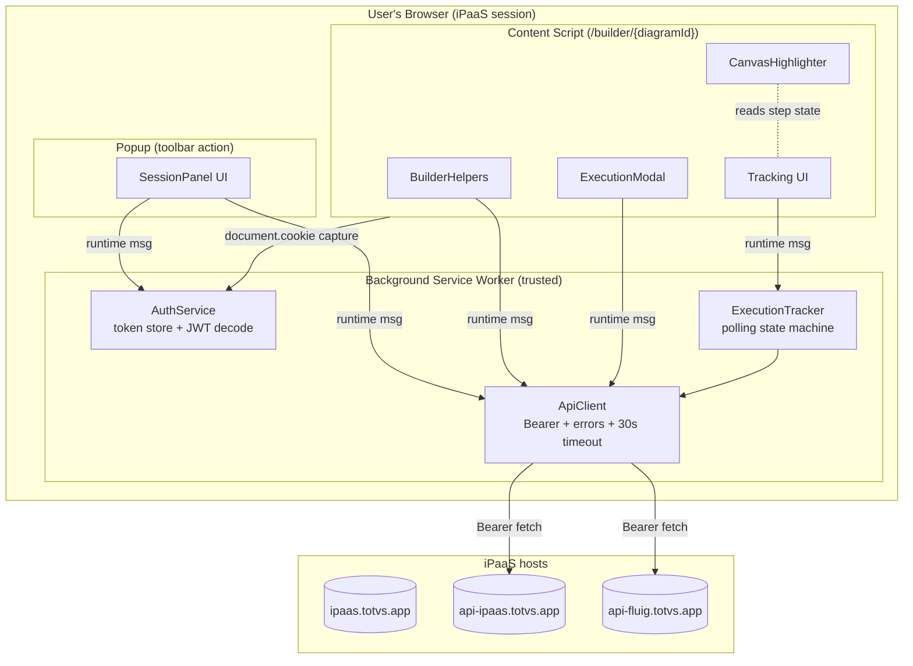
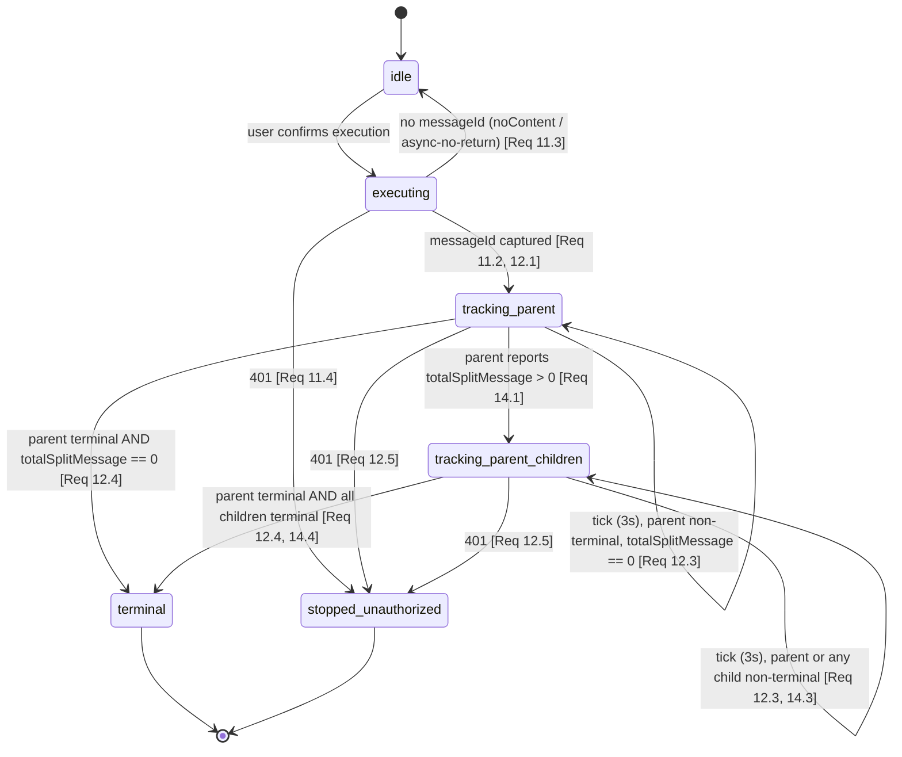

# Design Document

## Overview

The iPaaS Helper is a Chrome Manifest V3 (MV3) extension that augments the TOTVS iPaaS web app (`https://ipaas.totvs.app/`) with four read-mostly helpers:

1. **Session Panel** — a toolbar popup that reads the session JWT, decodes it, and resolves the effective role (Requirements 2–4, 16).
2. **Builder helpers** — content-script enhancements on `/builder/{diagramId}` pages that load the flow, annotate each function with its origin app, and summarize conditions (Requirements 5–7).
3. **Execution** — a trigger button on a webhook start node plus a modal to send a request body/headers and fire an authenticated run (Requirements 8–11).
4. **Execution tracking** — a polling engine that follows the resulting message to a terminal state, lists steps, aggregates splitter child messages, and (best-effort) highlights the executed path on the canvas (Requirements 12–15).

Every authenticated call carries an `Authorization: Bearer {jwt.token}` header reconstructed from the session cookie, because the cookie alone returns HTTP 401 (Requirement 16). All sensitive business data stays inside the user's browser and is sent only to the iPaaS API hosts (Requirement 17).

### Design Goals and Constraints

- **MV3 compliance.** No persistent background page; a service worker handles privileged work (token storage, cross-origin fetch); the token itself is captured by the content script from `document.cookie`. This also satisfies the "network calls from a trusted context" need and keeps CSP strict.
- **Least privilege.** Host permissions are limited to exactly the three required hosts (Requirement 1.5). The `storage` permission holds the Captured_Token in `chrome.storage.session`; the `cookies` permission is not used (Req 1.6, 2.1).
- **Read-only by default.** Only the Execute flow mutates server state, and only after an explicit user confirmation in the modal (Requirements 8.5, 11.1).
- **Best-effort canvas highlighting.** Requirement 15 is explicitly desirable; the DOM targeting is isolated so its failure never degrades the textual tracking (Requirement 15.3).

### Confirmed Technical Facts Grounding the Design

| Fact | Source | Design impact |
| --- | --- | --- |
| `jwt.token` cookie is **not** HttpOnly | live DevTools | Read via `document.cookie` in the content script (see Session Token Capture Decision); `chrome.cookies` is deliberately NOT used. |
| Cookie alone → 401; APIs need `Authorization: Bearer {token}` | live DevTools | `ApiClient` injects the Bearer header on every call (Req 16.1). |
| `jwt.token` is shared across sibling TOTVS systems and partitioned per profile | live DevTools | Token must be captured from the iPaaS tab's `document.cookie`, not `chrome.cookies` (Req 2). |
| `roles` JWT claim is empty | live DevTools | Role must come from the Roles_API (Req 4). |
| Builder nodes are `<div id="{componentId}-{type}">`, one `svg.svg-connections` | live DevTools | `CanvasHighlighter` targets `div[id^="{componentId}"]`; canvas renders async so a `MutationObserver` is required. |
| `messageId` can be absent (`noContent` / async-no-return) | live DevTools | Execution reports "triggered, no tracking id" (Req 11.3). |
| Splitter parent carries `totalSplitMessage`; children are `sourceType=SPLITTED` | live DevTools | Child polling starts only when `totalSplitMessage > 0` (Req 14). |

## Architecture

### High-Level Component Map

The extension is split across three MV3 execution contexts plus the external iPaaS APIs. The **background service worker** is the only context that performs cross-origin fetches and holds the Captured_Token; the content script captures the token from `document.cookie` and the popup delegates work via `chrome.runtime` messaging. This centralizes authentication, error handling, and the Bearer header in one trusted place and keeps the Sensitive_Payload flow auditable (Requirements 16, 17, 18).



### Execution Contexts and Responsibilities

| Context | Entry point | Responsibilities | Why here |
| --- | --- | --- | --- |
| Service worker | `background.ts` | `AuthService` (token store + decode), `ApiClient`, `ExecutionTracker`; owns the Captured_Token and all cross-origin fetches | MV3 trusted context; cross-origin fetch with host permissions works without page CSP interference; the token itself is captured by the content script and handed to the worker |
| Popup | `popup.html` + `popup.ts` | `SessionPanel` rendering; requests decoded session + role from the worker | Toolbar action per Req 1.4 — not injected into pages |
| Content script | `content.ts` (matches `https://ipaas.totvs.app/*` for capture; builder helpers gated to `/builder/*`) | Captures `jwt.token` from `document.cookie` (Req 2); `BuilderHelpers`, `ExecutionModal`, tracking UI, `CanvasHighlighter`; reads `Diagram_Id` from the URL | Only the in-page context can read the correct tab/profile cookie; builder helpers scoped by a runtime path check (Req 1.1–1.3) |

### Session Token Capture Decision (document.cookie via content script)

The TOTVS identity cookie `jwt.token` is **shared across sibling systems on parent domains** and **partitioned per browser profile** (normal vs. Incognito). Two options exist for obtaining it:

- **`chrome.cookies.get`/`getAll` from the service worker.** Context-independent, but in practice returns the WRONG token: with a shared parent-domain cookie it can hand back a sibling system's session, and the worker's default cookie store is the normal profile even when the user is working in an Incognito iPaaS tab. This was observed live (HTTP 401 with a token whose `tenantIdpId` did not match the company the user was actually in).
- **`document.cookie` from the content script in the iPaaS tab.** The cookie is not HttpOnly, so the content script reads the exact token for the tab the user is viewing — correct company, correct profile (normal or Incognito), always current even after a company switch.

**Decision:** capture the token from `document.cookie` **in the content script of the iPaaS tab**, never from `chrome.cookies`. The Session_Panel popup triggers a capture by messaging the active iPaaS tab's content script (Capture_Action); the builder content script captures from its own `document.cookie` on activation. The captured value is stored in `chrome.storage.session` (the Session_Store), which is isolated per profile and cleared when the browser session ends. On any authenticated 401 the token is re-captured once and the call retried (Req 2, 16). This is the authoritative source and fixes the shared-identity / Incognito mismatch; the `cookies` permission is dropped in favor of `storage`.

### Messaging Protocol

A single typed request/response channel (`chrome.runtime.sendMessage`) connects UI contexts to the worker. Messages are a discriminated union on a `type` field (e.g. `CAPTURE_TOKEN`, `GET_SESSION`, `GET_ROLE`, `GET_FLOW`, `GET_KEYS`, `EXECUTE`, `TRACK_START`, `TRACK_STOP`). `CAPTURE_TOKEN` is sent by the popup to the active iPaaS tab's content script, which replies with the `jwt.token` read from `document.cookie`; the worker persists it in the Session_Store. Tracking is long-lived: `TRACK_START` opens a `chrome.runtime.Port` so the worker can stream polling updates to the content-script tracking UI, and `TRACK_STOP` / port disconnect halts it.

### Permissions (manifest)

```jsonc
{
  "manifest_version": 3,
  "permissions": ["storage"],
  "host_permissions": [
    "https://ipaas.totvs.app/",
    "https://api-ipaas.totvs.app/",
    "https://api-fluig.totvs.app/"
  ],
  "background": { "service_worker": "background.js", "type": "module" },
  "action": { "default_popup": "popup.html" },
  "content_scripts": [
    {
      "matches": ["https://ipaas.totvs.app/builder/*"],
      "js": ["content.js"],
      "run_at": "document_idle"
    }
  ]
}
```

No host permission outside the three required hosts is requested (Requirement 1.5). The content script match pattern plus a runtime path re-check (`/builder/{diagramId}`) enforce Requirements 1.1–1.3.

## Components and Interfaces

### AuthService (service worker)

Owns the Captured_Token lifecycle (persisted in `chrome.storage.session`), JWT decoding, and Bearer-header construction. The raw token is captured by the content script from `document.cookie` and handed to the worker; AuthService never calls `chrome.cookies`.

```typescript
interface AuthService {
  // Returns the Captured_Token from chrome.storage.session; null when none captured (Req 2.4, 16.3)
  getStoredToken(): Promise<string | null>;
  // Persists a token captured by the content script into the Session_Store (Req 2.2, 2.4)
  storeToken(token: string): Promise<void>;

  // Structural decode only, no signature verification (Req 2.3-2.5)
  decodeJwt(token: string): JwtDecodeResult;

  // Builds "Bearer {token}"; throws NoSessionError when token missing (Req 16.1, 16.3)
  buildBearerHeader(token: string): string;
}

type JwtDecodeResult =
  | { ok: true; claims: JwtClaims }
  | { ok: false; reason: "malformed_structure" }   // not exactly 3 dot-separated segments (Req 2.4)
  | { ok: false; reason: "payload_not_json" };      // base64url payload is not valid JSON (Req 2.5)
```

Decoding rules (Req 2.3–2.5): split on `.`; require exactly three segments; Base64URL-decode the **payload** (segment 2) only; `JSON.parse` it. No crypto. The signature segment is never inspected.

### SessionPanel (popup)

Pure rendering of session data obtained from the worker. Handles the display branches of Requirements 2–4:

- No session → "no active session found" (Req 2.2, 16.3).
- Malformed/undecodable token → structural error messages (Req 2.4, 2.5).
- Company as the tenant slug (`domain`→`tenantCode`) paired with the `companyId` UUID, plus User/env, each with a per-field "not available" fallback (Req 3.1–3.4).
- Expiration as local date/time; expired indicator distinct from active; unavailable indicator when `exp` missing/invalid (Req 3.5–3.7).
- Role name/type and feature list (Req 4.3, 4.4); 401 re-auth message (Req 4.5); a 404 shows "no role found for this user/tenant" (Req 4.7); other failures show "role unavailable"; all while keeping JWT-derived data (Req 4.6).

### ApiClient (service worker)

Typed wrappers over every endpoint. Centralizes Bearer injection, the 30-second timeout, and error classification so every requirement's error branches resolve to one place (Requirements 16, 18).

```typescript
interface ApiClient {
  getRole(userCode: string, tenantCode: string): Promise<ApiResult<Role>>;
  getIntegration(diagramId: string): Promise<ApiResult<Integration | null>>;
  getKeys(): Promise<ApiResult<ExecutionKey[]>>;
  execute(integrationId: string, apiKey: string, body: unknown, headers: Record<string, string>): Promise<ApiResult<ExecutionResponse>>;
  getMessage(messageId: string): Promise<ApiResult<Message>>;
  getSteps(integrationId: string, createdDate: string, messageId: string): Promise<ApiResult<ExecutionStep[]>>;
  getChildMessages(originMessageId: string, window: DateWindow): Promise<ApiResult<Message[]>>;
}

type ApiResult<T> =
  | { ok: true; data: T }
  | { ok: false; kind: "unauthorized" }             // HTTP 401 → re-auth (Req 16.2)
  | { ok: false; kind: "http_error"; status: number } // non-200 non-401 (Req 18.3)
  | { ok: false; kind: "network" }                   // fetch rejection (Req 18.1)
  | { ok: false; kind: "timeout" }                   // >30s (Req 18.2)
  | { ok: false; kind: "no_session" };               // cookie absent/empty (Req 16.3)
```

Every method: resolves the Bearer header (fails `no_session` if the cookie is empty), issues `fetch` wrapped in a 30s `AbortController`, and maps the outcome to `ApiResult`. UI layers switch on `kind` to render the requirement-specified messages. The `no_session` short-circuit means a missing cookie never produces an outbound call (Req 16.3).

### BuilderHelpers (content script)

Three pure resolvers plus their DOM rendering.

```typescript
interface BuilderHelpers {
  // Req 6: resolve origin app for each function from componentId/componentResourceId + activity origin metadata
  resolveFunctionOrigins(flow: Flow): FunctionOrigin[];

  // Req 7: readable summary per CONDITION activity
  summarizeConditions(flow: Flow): ConditionSummary[];

  // Req 8: decide whether the execute button should appear
  shouldShowExecuteButton(integration: Integration): boolean;
}

interface FunctionOrigin {
  functionId: string;
  functionName: string;
  originApp: string | null; // null → "not available" indicator (Req 6.3)
}

interface ConditionSummary {
  activityId: string;
  conditionType: string;              // Req 7.3
  clauses: ConditionClause[];         // empty → "no defined clauses" indicator (Req 7.4)
}

interface ConditionClause {
  input: string;
  operation: string;
  booleanOperator: string | null;     // null for the last clause (Req 7.2)
}
```

- **Origin resolution (Req 6.1):** map the function's `componentId`/`componentResourceId` to the related `Flow_Activity`, then read origin metadata (`ownerTenantName`, `componentAccountId`, `serviceId`, `isCustom`, `shared`). If no activity resolves or all origin fields are empty, origin is `null` (Req 6.3). Each listed function gets an indicator (Req 6.2, 6.4).
- **Condition summary (Req 7):** for each `CONDITION` activity emit `conditionType` and one clause per `configurations.conditions[]` entry carrying `input`, `operation`, and the `booleanOperator` joining it to the next clause; empty array → explicit "no clauses" marker.
- **Execute precondition (Req 8.1, 8.3, 8.4):** `true` only when `flow.start` resolves to a `WEBHOOK` start activity (sync or async, Req 8.2) **and** `integration.active === true` **and** `integration.status === "PUBLISHED"`.

### ExecutionModal (content script)

Opens on execute-button click (Req 8.5). Provides a JSON body input and an HTTP headers input (Req 10.1), validates both, and enables confirm only when both are valid (Req 10.2–10.4).

```typescript
interface ExecutionModal {
  validateBody(raw: string): { ok: true; value: unknown } | { ok: false; message: string };   // Req 10.2
  validateHeaders(raw: string): { ok: true; value: Record<string, string> } | { ok: false; message: string }; // Req 10.3
  canSubmit(): boolean; // true iff both validations pass (Req 10.4)
}
```

Header well-formedness (Req 10.3): each non-blank line must parse as a single `name: value` pair with a non-empty, token-valid name (RFC 7230 field-name characters) and a value with no control characters.

On confirm it calls `getKeys` to resolve the `Api_Key` (Req 9), then `execute` (Req 11), then hands the resulting `Message_Id` to the `ExecutionTracker`.

### ExecutionTracker (service worker)

The most complex component — a polling state machine detailed in its own section below. It owns parent-message polling, step fetching, splitter child aggregation, terminal detection, and the stop conditions (Requirements 12–14).

### CanvasHighlighter (content script, best-effort)

Isolated, failure-tolerant DOM enhancement (Requirement 15).

```typescript
interface CanvasHighlighter {
  // Returns true if the node was found and highlighted; false if not locatable (Req 15.3)
  highlight(componentId: string, status: StepStatus): boolean;
  clearAll(): void;
}
```

Targets `div[id^="${componentId}"]` on the single `svg.svg-connections`-bearing canvas, applies a status-colored CSS class via an injected stylesheet, and uses a `MutationObserver` because nodes render asynchronously after page load. If a node cannot be located, it returns `false` and the tracking UI proceeds textually with no visual change (Req 15.3). This component is never on the critical path of tracking.

## Data Models

All models are TypeScript interfaces shared across contexts (a `models.ts` module). Field names mirror the confirmed API payloads.

```typescript
// Req 2.3, 2.4 — decoded JWT claims (signature never verified)
interface JwtClaims {
  fullName?: string;
  login?: string;
  email?: string;
  companyId?: string;
  tenantCode?: string;
  tenantIdpId?: string; // IdP tenant UUID — the Tenant_Code the roles API expects
  domain?: string;      // human-readable tenant slug
  env?: string;
  partnerCompany?: string;
  sub?: string;
  userIdpId?: string;
  exp?: number; // Unix seconds (Req 3.5-3.7)
  iat?: number;
  [claim: string]: unknown; // tolerate unknown claims
}

// Req 4 — Roles_API response
interface Role {
  name: string;
  type: string;
  gatewayEnabled: boolean;
  features: FeaturePermission[];
}
interface FeaturePermission { id: string; name: string; }

// Req 5 — Integrations_API first item
interface Integration {
  id: string;
  name: string;
  active: boolean;
  status: string; // "PUBLISHED" gates execute (Req 8)
  flow: Flow;
}
interface Flow {
  async: boolean;
  functions: Record<string, FlowFunction>;
  activities: Record<string, FlowActivity>;
  start: string;            // id into activities (Req 8.1)
  globalErrorFlow?: unknown;
}
interface FlowFunction {
  id: string;
  name: string;
  type: string;             // e.g. "FUNCTION_JOLT"
  label: string;
  params?: unknown;
  componentId: string;
  componentResourceId: string;
  connections?: unknown;
}
interface FlowActivity {
  type: string;             // "WEBHOOK", "CONDITION", ...
  ownerTenantName?: string;
  componentAccountId?: string;
  serviceId?: string;
  isCustom?: boolean;
  shared?: boolean;
  configurations?: ConditionConfig; // present for CONDITION
}
interface ConditionConfig {
  conditionType: string;
  conditions: ConditionClauseRaw[];
}
interface ConditionClauseRaw {
  input: string;
  operation: string;
  booleanOperator?: string;
}

// Req 9 — Keys_API entries
interface ExecutionKey {
  id: string;
  integrationId: string;
  apiKey: string;
  eai: boolean;
  noContent: boolean;       // Req 11.3
  sync: boolean;
  diagram: { id: string; name: string };
  project: { id: string; name: string; type: string };
}

// Req 11 — Execute_API response (messageId may be absent)
interface ExecutionResponse {
  status: string;
  messageId?: string;       // absent → no tracking id (Req 11.3)
  timestamp: string;
}

// Req 12, 14 — Message_Detail / Child_Messages
type MessageStatus = "PROCESSING" | "DONE" | "ERROR" | "REPROCESSED";
interface Message {
  id: string;
  integrationId: string;
  diagramId: string;
  diagramName: string;
  status: MessageStatus;
  executionTime: number;
  initialComponent: string;
  finalComponent: string;
  sourceType: "ORIGINAL" | "SPLITTED";
  originMessageId?: string;
  totalSplitMessage: number;   // >0 → poll children (Req 14.1)
  message?: unknown;           // Sensitive_Payload (Req 17)
}

// Req 13 — Steps_API entries
type StepStatus = "PROCESSING" | "DONE" | "ERROR" | "REPROCESSED";
interface ExecutionStep {
  messageId: string;
  componentId: string;         // targets canvas node (Req 15)
  activityLabel: string;
  status: StepStatus;
  startDate: string;
  endDate?: string;
  inMessage?: unknown;         // Sensitive_Payload (Req 17)
  outMessage?: unknown;        // Sensitive_Payload (Req 17)
  inHeaders?: unknown;         // Sensitive_Payload (Req 17)
  outHeaders?: unknown;        // Sensitive_Payload (Req 17)
  functions?: unknown;
  condition?: unknown;
  resourceType?: string;
}

// Terminal state helper (Req 12.4, 13, 14.4)
const TERMINAL: ReadonlySet<string> = new Set(["DONE", "ERROR"]);
function isTerminal(status: string): boolean { return TERMINAL.has(status); }

interface DateWindow { initialDate: string; finalDate: string; }
```

### ExecutionTracker State Machine

The tracker polls the parent Message every 3 seconds, and — only when the parent reports `totalSplitMessage > 0` — begins polling splitter child messages on the same cadence. Polling stops only when the parent **and** every applicable child have reached a Terminal_State (`DONE`/`ERROR`). A 401 stops everything; other transient errors keep polling at the next tick.

**States**

- `idle` — no tracking active.
- `executing` — the Execute POST is in flight (Req 11.1).
- `tracking_parent` — parent polling active; no splitter detected yet.
- `tracking_parent_children` — parent still non-terminal and/or children being polled because `totalSplitMessage > 0`.
- `terminal` — parent and all applicable children terminal; polling stopped (Req 12.4, 14.4).
- `stopped_unauthorized` — a 401 halted polling (Req 12.5).



Transient (non-401) tracking failures do **not** change state: the tracker surfaces a "tracking update failed" / "child message update failed" message and retries on the next 3s tick (Req 12.6, 14.5). Step-fetch failures likewise retain the message display (Req 13.4).

**One polling cycle (sequence)**

```mermaid
sequenceDiagram
    participant UI as Tracking UI (content script)
    participant TRK as ExecutionTracker (worker)
    participant API as ApiClient
    participant IP as api-ipaas.totvs.app

    UI->>TRK: TRACK_START(messageId, integrationId)
    loop every 3 seconds until terminal
        TRK->>API: getMessage(messageId)
        API->>IP: GET messages/{id} (Bearer)
        IP-->>API: Message{status,totalSplitMessage,...}
        API-->>TRK: ApiResult<Message>
        TRK->>API: getSteps(integrationId, createdDate, messageId)
        API->>IP: GET steps/... (Bearer)
        IP-->>API: ExecutionStep[]
        API-->>TRK: ApiResult<ExecutionStep[]>
        alt totalSplitMessage > 0
            TRK->>API: getChildMessages(messageId, window)
            API->>IP: GET messages?sourceTypes=SPLITTED&originMessageId=... (Bearer)
            IP-->>API: Message[] (children)
            API-->>TRK: ApiResult<Message[]>
        end
        TRK-->>UI: update(status, steps, childAggregate)
        alt 401 on any call
            TRK-->>UI: re-auth message; stop
        else parent terminal AND all children terminal
            TRK-->>UI: final state; stop
        end
    end
```

**Child aggregation (Req 14.2):** the tracker computes counts of children in `DONE`, `ERROR`, and `PROCESSING` against `totalSplitMessage` and emits them each tick; when all children are terminal it emits the final aggregate (Req 14.4). Children are considered "all terminal" when the count of terminal children equals `totalSplitMessage` (so late-appearing children do not prematurely end polling).

## Correctness Properties

*A property is a characteristic or behavior that should hold true across all valid executions of a system — essentially, a formal statement about what the system should do. Properties serve as the bridge between human-readable specifications and machine-verifiable correctness guarantees.*

This feature is well suited to property-based testing: the JWT decoder, the builder resolvers (function origin, condition summary, execute precondition), the modal validators, the key selector, and the tracker's terminal/aggregation logic are all pure functions whose behavior varies meaningfully across a large input space. The following properties are the consolidated, non-redundant set derived from the prework analysis. UI timing, cookie/DOM I/O, and architectural guarantees are covered by example, integration, and smoke tests instead (see Testing Strategy).

### Property 1: JWT payload decode round-trip

*For any* JSON object used as a JWT payload, encoding it as the middle Base64URL segment of a three-segment token (with arbitrary header and signature segments) and decoding it with the JWT_Decoder yields claims equal to the original object, independent of the signature segment.

**Validates: Requirements 2.3**

### Property 2: Malformed token structure detection

*For any* string, the JWT_Decoder returns `malformed_structure` if and only if the string does not consist of exactly three Base64URL segments separated by exactly two dots.

**Validates: Requirements 2.4**

### Property 3: Undecodable payload detection

*For any* three-segment token whose middle segment does not Base64URL-decode into a syntactically valid JSON object, the JWT_Decoder returns `payload_not_json`.

**Validates: Requirements 2.5**

### Property 4: Builder path-activation guard

*For any* URL path, the builder activation guard returns true if and only if the path matches `/builder/{diagramId}` with a single non-empty diagram segment.

**Validates: Requirements 1.3**

### Property 5: Diagram id extraction

*For any* Builder_Page URL whose path matches `/builder/{diagramId}`, the extracted Diagram_Id equals that path segment.

**Validates: Requirements 5.1**

### Property 6: Session field mapping with per-field fallback

*For any* decoded JwtClaims object, the Session_Panel view-model maps User and environment each independently to its claim value when present and non-empty, and Company to the tenant slug (`domain`→`tenantCode`) paired with the `companyId` UUID; each field falls back to the not-available indicator when its sources are absent/empty, and the absence of any one field never changes the mapped result of another field.

**Validates: Requirements 3.1, 3.2, 3.3, 3.4**

### Property 7: Expiration classification

*For any* `exp` value and any reference time `now`, the Session_Panel classifies the session as expired if and only if `exp` is a valid Unix-timestamp integer earlier than `now`, as active when it is a valid timestamp not earlier than `now`, and as unavailable when `exp` is absent or not a valid integer — and in every case the other decoded values are retained.

**Validates: Requirements 3.6, 3.7**

### Property 8: User and tenant code derivation

*For any* decoded JwtClaims, the User_Code resolves to the `userIdpId` claim and the Tenant_Code resolves to the `tenantIdpId` claim (each falling back to the not-available indicator when absent/empty); the slug `tenantCode` and the email `sub` are NOT used, as the roles API is keyed by the IdP UUIDs.

**Validates: Requirements 4.1**

### Property 9: Role feature-list completeness

*For any* successful Role response, the rendered feature list contains the `name` of every entry in the Role `features` array, with no feature omitted or duplicated.

**Validates: Requirements 4.4**

### Property 10: Function-origin resolution completeness

*For any* Flow, `resolveFunctionOrigins` returns exactly one entry per `flow.functions` function, each carrying an origin resolved from the function's `componentId`/`componentResourceId` and the matched activity's origin metadata, or the not-available indicator when it cannot be resolved; an unresolved function never suppresses or alters the resolved origin of another function.

**Validates: Requirements 6.1, 6.2, 6.3, 6.4**

### Property 11: Condition-summary completeness

*For any* Flow, `summarizeConditions` returns exactly one summary per `CONDITION` activity, each summary carrying the activity's `conditionType` and, for each entry in `configurations.conditions[]`, the `input`, `operation`, and the `booleanOperator` joining it to the next clause (null for the last); a condition with an empty `conditions[]` array yields a summary flagged as having no defined clauses.

**Validates: Requirements 7.1, 7.2, 7.3, 7.4**

### Property 12: Execute-button precondition

*For any* Integration, `shouldShowExecuteButton` returns true if and only if the Start_Activity resolved from `flow.start` is a `WEBHOOK` trigger (whether synchronous or asynchronous) **and** `active` is true **and** `status` equals `PUBLISHED`.

**Validates: Requirements 8.1, 8.2, 8.3, 8.4**

### Property 13: Execution-key selection

*For any* list of Execution_Keys and current Integration, the selector returns the key whose `integrationId` equals the Integration `id` or whose `diagram.id` equals the current Diagram_Id, and returns none when no key matches; a selected key exposes its `apiKey`, `sync`, and `noContent`.

**Validates: Requirements 9.2, 9.3**

### Property 14: Execution-modal submit gating

*For any* body input and header input, `canSubmit()` returns true if and only if the body parses as valid JSON **and** every non-blank header line is a well-formed name-and-value pair; when either validator fails, submission is blocked.

**Validates: Requirements 10.2, 10.3, 10.4**

### Property 15: Step ordering and error indication

*For any* array of Execution_Steps, the rendered steps appear in the same order as returned, each showing its `activityLabel`, `status`, `startDate`, and `endDate`, and a step is marked with the error indicator if and only if its `status` is `ERROR`, distinct from the `DONE` and `PROCESSING` indicators.

**Validates: Requirements 13.2, 13.3**

### Property 16: Tracker terminal detection

*For any* sequence of parent Message statuses and child Message statuses, the ExecutionTracker polls children if and only if the parent's `totalSplitMessage` is greater than 0, continues polling while the parent or any applicable child is non-terminal, and reaches the terminal (stopped) state exactly when the parent and all `totalSplitMessage` children have reached a Terminal_State (`DONE` or `ERROR`).

**Validates: Requirements 12.3, 12.4, 14.1, 14.3, 14.4**

### Property 17: Tracker transient-error continuation

*For any* non-401 error (non-200 response, network error, or timeout) returned on a polling tick, the ExecutionTracker remains in a polling state and retries on the next 3-second interval rather than stopping.

**Validates: Requirements 12.6, 14.5**

### Property 18: Child-message aggregation counts

*For any* list of Child_Messages for a parent with `totalSplitMessage` splits, the aggregate reports the exact counts of children in `DONE`, `ERROR`, and `PROCESSING`, and those counts never exceed `totalSplitMessage` and sum to the number of observed children.

**Validates: Requirements 14.2**

### Property 19: Canvas-highlighter isolation

*For any* Execution_Step whose canvas node cannot be located, `highlight` returns false and the textual tracking output is identical to the output produced with no highlighter active.

**Validates: Requirements 15.3**

### Property 20: Bearer header injection

*For any* ApiClient call made while the Session_Cookie is present and non-empty, the outgoing request includes the header `Authorization: Bearer {cookie}` built from the cookie value.

**Validates: Requirements 16.1**

### Property 21: Unauthorized classification

*For any* endpoint, when the response status is 401 the ApiClient result is `kind: "unauthorized"`.

**Validates: Requirements 16.2**

### Property 22: No-session guard

*For any* authenticated call attempted while the Session_Cookie is absent or empty, the ApiClient returns `kind: "no_session"` and issues no outbound request.

**Validates: Requirements 16.3**

### Property 23: Allowed-host restriction

*For any* request the ApiClient issues, the request URL host is one of `ipaas.totvs.app`, `api-ipaas.totvs.app`, or `api-fluig.totvs.app`; no Sensitive_Payload, Session_Cookie value, or JWT_Claim is ever sent to any other host.

**Validates: Requirements 17.2, 17.3**

### Property 24: Error-outcome classification

*For any* endpoint, a fetch rejection yields `kind: "network"`, a call exceeding 30 seconds yields `kind: "timeout"`, and a non-200 response other than 401 yields `kind: "http_error"` with the returned status preserved.

**Validates: Requirements 18.1, 18.2, 18.3**

## Error Handling

All error handling is centralized in the `ApiClient` so every requirement's failure branch resolves to one of a fixed set of `ApiResult` outcomes, and each UI layer maps those outcomes to the requirement-specified message.

| Outcome (`ApiResult.kind`) | Trigger | UI behavior | Requirements |
| --- | --- | --- | --- |
| `no_session` | Cookie absent/empty at call time | "No active session found"; **no request sent** | 2.2, 16.3 |
| `unauthorized` | HTTP 401 | "Session unauthorized or expired — please re-authenticate"; tracking stops | 4.5, 5.5, 9.4, 11.4, 12.5, 16.2 |
| `timeout` | No completion within 30s (AbortController) | "{operation} timed out" | 18.2 |
| `network` | `fetch` rejection | "{operation} failed (network)"; previously displayed data left unchanged | 18.1 |
| `http_error` | Non-200, non-401 | "{operation} failed with status {status}" | 4.6, 5.6, 9.5, 11.5, 13.4, 18.3 |

Behavioral rules layered on top of the table:

- **Timeout:** every `fetch` is wrapped in a 30-second `AbortController`; abortion is reported as `timeout` and surfaced per operation (Req 18.2).
- **Preserve prior data on transient failure:** network/timeout/http errors never clear already-rendered session, flow, message, or step data (Req 18.1, 13.4).
- **Tracking continuation:** inside the tracker, `unauthorized` stops all polling (Req 12.5); any other error surfaces a "tracking update failed" / "child message update failed" message and polling continues at the next tick (Req 12.6, 14.5).
- **Builder inactivation:** when the Integrations_API returns no items or a non-401 failure, the builder helpers stay inactive and show "flow data unavailable/could not be loaded" (Req 5.4, 5.6).
- **No tracking id:** when the Execute_API response has no `messageId` (because `noContent` is true or the webhook is async without a return), the user is told the run was triggered but no tracking id is available (Req 11.3).
- **Best-effort highlight:** a missing canvas node is not an error — `highlight` returns false and tracking proceeds textually (Req 15.3).

## Testing Strategy

The feature uses a **dual approach**: property-based tests for the pure logic with large input spaces, and example/integration/smoke tests for I/O, UI, timing, and configuration.

### Property-Based Tests

- **Library:** `fast-check` with Vitest (TypeScript). Property-based testing is **not** implemented from scratch.
- **Iterations:** each property test runs a minimum of **100 iterations**.
- **Mapping:** each of Properties 1–24 is implemented by a **single** property-based test.
- **Tag format** (comment on each test): `Feature: ipaas-helper-extension, Property {number}: {property_text}`.
- **Mocks for I/O:** `ApiClient` properties (20–24) use a stubbed `fetch` and a stubbed cookie reader so the Bearer-injection, host-allowlist, and error-classification properties run cheaply at 100+ iterations without real network calls. The `ExecutionTracker` properties (16–18) use a fake timer and a scripted sequence of mocked `getMessage`/`getChildMessages` results so terminal detection and transient-error continuation are tested as a pure state machine.
- **Generators of note:** JWT generators that emit valid payloads plus adversarial segment counts and non-JSON payloads (Props 1–3); flow generators that emit functions with resolvable and unresolvable origins and conditions with empty and populated clause arrays (Props 10–11); integration generators spanning webhook/non-webhook, active/inactive, published/unpublished, sync/async (Prop 12); parent/child status sequence generators including splitter counts and late-arriving children (Prop 16).

### Unit / Example Tests

Cover specific behaviors and branches that are not universal properties:

- JWT local date/time formatting under a fixed locale/zone (Req 3.5).
- Request construction for each endpoint: Roles_API query + Bearer, Integrations_API `fieldsReturn`/`pageSize=1` and first-item selection, Keys_API body `{}`, Execute_API POST shape, Steps_API path, Child_Messages_API query (Req 4.2, 5.2, 5.3, 9.1, 11.1, 13.1).
- Branch outcomes: 401 re-auth, empty items, no-key-match disable, `messageId` present vs absent (Req 2.2, 4.3, 4.5, 5.4, 9.3, 11.2, 11.3, 11.4).
- Execution-modal rendering of both inputs and open-on-click (Req 8.5, 10.1).
- Tracker cadence with fake timers: 3-second interval and display of `status`/`executionTime`/`initialComponent`/`finalComponent` (Req 12.1, 12.2).

### Integration / DOM Tests

- Builder activation on `/builder/{id}` and inactivation elsewhere, including the within-2s activation after DOM mutations (Req 1.1, 1.2).
- Content-script capture of `jwt.token` from `document.cookie` and persistence to `chrome.storage.session`, with a mocked extension API (Req 2.1–2.4).
- `CanvasHighlighter` against a fixture canvas: node located → class applied and updated to terminal status; node absent → `highlight` returns false (Req 15.1, 15.2).

### Smoke / Configuration Tests

- Manifest assertions: `host_permissions` equals exactly the three allowed hosts and nothing else (Req 1.5); `action.default_popup` set and no content script injects the panel (Req 1.4); `storage` permission present and `cookies` permission absent (Req 1.6).
- Review-level confirmation that Sensitive_Payloads render only in the session UI and are never routed to a third-party host (Req 17.1), reinforced by the allowed-host property (Prop 23).

### Security and Sensitive-Data Notes

The JWT, Session_Cookie value, and all Sensitive_Payloads (`message`, `inMessage`, `outMessage`, `inHeaders`, `outHeaders`) are read and rendered only inside the user's own browser session and are transmitted only to the three allowlisted iPaaS hosts as part of the specified authenticated calls. The host-permission allowlist, the `ApiClient` host restriction (Prop 23), and the absence of any third-party endpoint in the design enforce Requirement 17.

## Technology and Project Layout

- **Language:** TypeScript. **Platform:** Chrome Manifest V3.
- **Build:** Vite with `@crxjs/vite-plugin` (lightweight, HMR for the popup/content script, emits an MV3-compliant bundle). esbuild alone is a viable fallback; Vite is chosen for its first-class MV3 and multi-entry support.
- **Test runner:** Vitest + `fast-check`; DOM tests use `jsdom`; `chrome.*` APIs are mocked (e.g. `sinon-chrome`).

```
ipaas-extension/
├─ manifest.json
├─ vite.config.ts
├─ src/
│  ├─ background.ts            # service worker entry (AuthService, ApiClient, ExecutionTracker)
│  ├─ content.ts               # builder content-script entry
│  ├─ popup.html / popup.ts    # SessionPanel
│  ├─ models.ts                # shared interfaces (JwtClaims, Role, Integration, Message, ...)
│  ├─ auth/auth-service.ts
│  ├─ api/api-client.ts
│  ├─ builder/builder-helpers.ts
│  ├─ builder/execution-modal.ts
│  ├─ builder/canvas-highlighter.ts
│  ├─ tracking/execution-tracker.ts
│  └─ messaging/protocol.ts    # typed runtime message union + Port contract
└─ test/                       # *.property.test.ts, *.test.ts, dom/, smoke/
```

## Requirements Traceability Summary

| Requirement | Primary design elements |
| --- | --- |
| 1 Domain/host scoping | Manifest `matches`/`host_permissions`, path-activation guard (Prop 4), toolbar popup |
| 2 Capture token & decode JWT | Content-script `document.cookie` capture, Session_Store, AuthService, JWT_Decoder (Props 1–3) |
| 3 Company/User/exp | SessionPanel field mapping (Prop 6), expiration classification (Prop 7) |
| 4 Effective role | AuthService code derivation (Prop 8), ApiClient.getRole, feature list (Prop 9) |
| 5 Load flow | ApiClient.getIntegration, diagram-id extraction (Prop 5) |
| 6 Function origin | BuilderHelpers.resolveFunctionOrigins (Prop 10) |
| 7 Condition summary | BuilderHelpers.summarizeConditions (Prop 11) |
| 8 Execute button | BuilderHelpers.shouldShowExecuteButton (Prop 12) |
| 9 Resolve key | ApiClient.getKeys + key selection (Prop 13) |
| 10 Modal validation | ExecutionModal validators (Prop 14) |
| 11 Trigger execution | ApiClient.execute, ExecutionResponse handling |
| 12–14 Tracking | ExecutionTracker state machine (Props 16–18), steps (Prop 15), child aggregation |
| 15 Canvas highlight | CanvasHighlighter (Prop 19), best-effort |
| 16 Auth | ApiClient Bearer injection (Prop 20), 401 (Prop 21), no-session guard (Prop 22) |
| 17 Sensitive data | Host allowlist (Prop 23), smoke tests |
| 18 Error handling | ApiClient error classification (Prop 24) |
